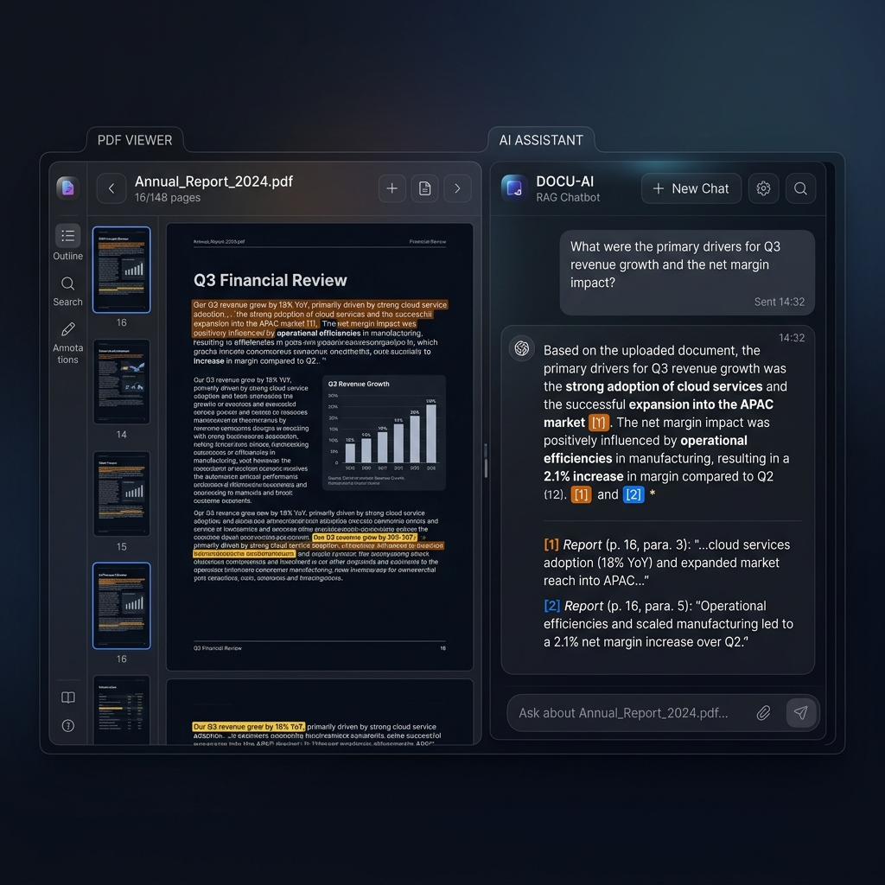

# Billa Komal Sushank - Interactive AI Digital Business Card

A premium, production-ready **Interactive Digital Business Card & AI Portfolio Assistant** built using HTML5, CSS Glassmorphic Design System, Vanilla JavaScript, Vercel Serverless Functions, and Azure AI Inference API.



## 🌟 Highlights & Key Features

- **Dark Luxury Aesthetics**: Obsidian theme with animated CSS Aurora background blobs, glassmorphism panel styling, translucent blur effects, and Google Fonts (`Outfit` & `Inter`).
- **Interactive Hero**: Dynamic typewriter headline animation introducing Sushank's engineering specializations, status pill indicator, and fast call-to-actions.
- **7 Featured Projects**:
  1. **MediPro AI**: Enterprise Healthcare SaaS & Medical Document AI ([Live Demo](https://capstone-five-tau.vercel.app/) | [GitHub](https://github.com/Sushank47/Capstone.git))
  2. **Language AI**: Review Sentiment Analyzer ([Live Demo](https://language-ai-lovat.vercel.app) | [GitHub](https://github.com/Sushank47/LANGUAGE_AI.git))
  3. **Vision AI**: Image Captioning & OCR Platform ([Live Demo](https://vision-ai-puce.vercel.app) | [GitHub](https://github.com/Sushank47/VISION-AI.git))
  4. **Speech AI**: Real-Time Speech Transcription & Voice Generator ([Live Demo](https://speech-ai-six.vercel.app) | [GitHub](https://github.com/Sushank47/SPEECH-AI.git))
  5. **Azure OpenAI**: AI FAQ Chatbot ([Live Demo](https://azure-ai-woad.vercel.app) | [GitHub](https://github.com/Sushank47/Azure-AI.git))
  6. **Document Intelligence Chatbot (RAG)**: PDF Q&A with Zero Hallucinations ([Live Demo](https://rag-two-gamma.vercel.app) | [GitHub](https://github.com/Sushank47/RAG.git))
  7. **Employee Management System**: Full-Stack CRUD Portal with Auth & RBAC ([Live Demo](https://employee-management-system-ebon-sigma.vercel.app) | [GitHub](https://github.com/Sushank47/Employee-Management-System-.git))
- **"Ask AI" Integration**: Clicking "Ask AI" on any project card slides open the AI Assistant and automatically pre-fills a detailed query about that project!
- **AI Portfolio Assistant**: Modern ChatGPT-style chat drawer with typing animations, markdown support, suggested question chips, copy response button, auto-scroll, and `localStorage` conversation history.
- **Strictly Grounded Assistant**: The system prompt in `api/systemPrompt.js` enforces strict boundaries. The AI answers only questions about Sushank's work, tech stack, and links, and politely refuses off-topic requests.
- **Secure Serverless Architecture**: Client-side JS never touches API keys. Requests route securely through `/api/chat.js` Vercel Serverless Function reading `AZURE_AI_ENDPOINT` and `AZURE_AI_API_KEY`.

---

## 📁 Modular File Structure

```text
AI Portfolio Assistant/
├── index.html               # Main HTML markup
├── css/
│   └── styles.css           # Glassmorphism, Aurora, & Typography design system
├── js/
│   ├── config.js            # Editable profile configuration & social links
│   ├── projects.js          # Editable 7 projects data array
│   ├── chat.js              # AI Assistant chat controller & Markdown parser
│   └── app.js               # Main application logic & typewriter effect
├── api/
│   ├── chat.js              # Vercel Serverless Function (Azure AI Inference proxy)
│   └── systemPrompt.js      # System prompt & knowledge base for Sushank
├── assets/
│   └── images/              # Project preview thumbnail images
├── vercel.json              # Vercel routing configuration
├── package.json             # Project metadata & dependencies
└── .env.example             # Environment variable template
```

---

## 🚀 How to Deploy on Vercel

1. **Push Code to GitHub**:
   ```bash
   git init
   git add .
   git commit -m "Initial commit of Interactive AI Digital Business Card"
   git remote add origin https://github.com/Sushank47/YOUR-REPO-NAME.git
   git push -u origin main
   ```

2. **Deploy to Vercel**:
   - Go to [Vercel Dashboard](https://vercel.com) and click **Add New Project**.
   - Import your repository.

3. **Configure Environment Variables in Vercel**:
   In Vercel Project Settings -> **Environment Variables**, add:
   - `AZURE_AI_ENDPOINT`: Your Azure AI Inference Endpoint URL
   - `AZURE_AI_API_KEY`: Your Azure AI API Key
   - `AZURE_AI_MODEL_NAME`: `gpt-4o` (or your deployed Azure AI model name)

4. **Deploy!** Your site will be live instantly with a working AI Assistant!
